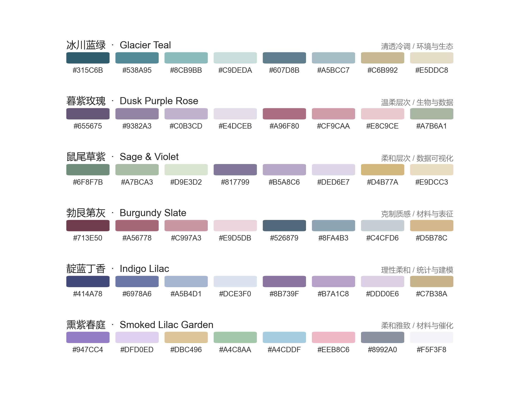

# sci-color-palettes · 科研配色

> **184 publication-ready colour schemes** for SCI figures — 6 transcribed designs
> plus 178 generated variants — each audited for colour-blind safety and print
> contrast, and ranked for **basic research**, **clinical research** and
> **database / registry** work.

[](https://www.python.org/)
[](LICENSE)
[](#the-library)

The six anchor palettes come from the **科研配色** (Scientific Colour
Schemes) series, where each article shows one 8-colour scheme as a figure.
This repository turns them into hex data a script can use, then derives 178
variants by hue rotation, temperature drift, chroma and contrast changes,
monochrome collapse and cross-palette blending — audited and scored.

The figures are renders, so there is no earlier non-image source of these
colours. The six anchor values are the hex labels printed on the swatches;
[references/raw-rgb-measurements.md](references/raw-rgb-measurements.md) also
records the raw RGB read straight off those swatches, next to the labels, so the
choice is auditable. In this repository **"original" means the colours in the
reference figures** — the anchor palettes and their 178 variants are all derived
from them.



## Pick by field first

Clinical and database figures have hard requirements that basic-research figures
do not: they are read by colour-blind clinicians and printed in greyscale. So
the library is scored per field rather than on one quality number.

```python
import sci_palettes as sp

sp.suggest_for("临床", n=5)          # clinical: survival, forest, adverse events
sp.suggest_for("数据库", n=5)        # database/registry: cohorts, centres, sites
sp.suggest_for("基础", n=5)          # basic research: greyscale-safe panels
```

| Field | Hard requirement | Typical best pick |
|---|---|---|
| 临床 clinical | colour-vision separation ≥ 5 on the best 5, ≥ 2 dark members, lightness span ≥ 0.40 | `burgundy-clin-hi` |
| 数据库 database | pairwise separation ≥ 10 and hue spread ≥ 60° on the best 5 | `lilac_garden-clin-hi` |
| 基础 basic | lightness span ≥ 0.45, colour-vision separation ≥ 4 | `burgundy-clin` |
| 通用 general | no extra gate; ranked by span, separation and dark members | `glacier+hues` |

Of 184 schemes, **25** clear the clinical gates, **37** the database gates,
**63** the basic gates. Every result carries a `score`, a pass/fail `fits` flag
and a plain-language `why`, so a recommendation can be checked rather than
trusted. Criteria and rationale: **[references/applications.md](references/applications.md)**.

```python
print(sp.applications("burgundy-clin-hi")["scores"])
# {'clinical': 80, 'database': 68, 'basic': 92, 'general': 92}
```

## The six anchor palettes

| Palette | 中文名 | English | Designed for |
|---|---|---|---|
| <br>`glacier` | 冰川蓝绿 | Glacier Teal | environment, ecology, water quality, climate |
| <br>`dusk_rose` | 暮紫玫瑰 | Dusk Purple Rose | biology, omics, dose-response, group comparison |
| <br>`sage` | 鼠尾草紫 | Sage & Violet | general visualisation; the most colour-blind safe |
| <br>`burgundy` | 勃艮第灰 | Burgundy Slate | materials, chemistry, XRD / XPS / TGA |
| <br>`indigo` | 靛蓝丁香 | Indigo Lilac | statistics, modelling, PCA and regression |
| <br>`lilac_garden` | 熏紫春庭 | Smoked Lilac Garden | catalysis, pastel multi-hue panels |

Hex values, roles and per-palette audits: **[references/palettes.md](references/palettes.md)**.

## The library

| Family | Count | What it is for |
|---|---|---|
| `hue_rotate` | 76 | the same scheme at another hue angle (30° steps; 15° for glacier/sage) |
| `temperature` | 24 | warm / cool drift |
| `blend` | 12 | two anchor palettes mixed (e.g. `glacier+dusk_rose`) |
| `clinical` | 12 | widest practical lightness span; survival and forest panels |
| `contrast` | 12 | a lifted (`-light`) or deepened (`-dark`) ramp |
| `diverging` | 12 | symmetric scales for reference ranges (`div-wine-teal`, …) |
| `chroma` | 9 | muted / soft / rich saturation |
| `complement` | 6 | every hue moved to its opposite |
| `basic` | 6 | restrained chroma, evenly spaced lightness |
| `database` | 6 | `<base>+hues`: each member a further hue step, for many cohorts |
| `monochrome` | 3 | one hue family, lightness only |

Every generated id encodes its transform, so it is reproducible and readable:
`glacier-h030` is glacier rotated 30°, `burgundy-clin` is burgundy tuned for
clinical panels, `sage-mono` is a single-hue sage ramp.

```python
sp.derived_names()                 # all 178 generated ids
sp.family("clinical")              # one family, best score first
sp.family("glacier")               # every variant of one anchor palette
sp.search("#315C6B")               # palettes containing a colour you must use
sp.recommend(n=10, min_score=70)
sp.stats()                         # counts per family and per field
```

Full hex tables: **[references/derived-palettes.md](references/derived-palettes.md)**.

## Install

```bash
git clone https://github.com/Xiong-ding-kan/sci-color-palettes.git
cd sci-color-palettes
pip install -e .                      # matplotlib stays optional
```

No install wanted? Add `scripts/` to `PYTHONPATH` and import directly.

## Use

```python
import matplotlib.pyplot as plt
import sci_palettes as sp

sp.set_theme("burgundy-clin-hi")    # palette + paper styling, one line
C  = sp.palette("burgundy-clin-hi") # the 8 hex strings
cm = sp.colormap("burgundy-clin-hi")
```

Chinese names work as aliases everywhere: `sp.set_theme("冰川蓝绿")`.

### Choosing the right number of colours

```python
sp.select(sp.palette("sage-mono"), 5)   # 5 real palette colours, hues preserved
sp.ramp(sp.palette("sage"), 6)          # 6 blended steps, for gradients
sp.sub("sage", 4)                       # 4 consecutive ramp members
```

`select` is for categories (it returns colours that exist in the palette and
satisfies the separation figures quoted above); `ramp` is for continuous scales;
the `div-*` ramps are for signed data with a midpoint.

### Check it before you submit

```python
print(sp.report("indigo"))
```

```
palette      indigo  (靛蓝丁香, 8 colours)
ramp         #414A78 #6978A6 #A5B4D1 #DCE3F0 #8B739F #B7A1C8 #DDD0E6 #C7B38A
close pairs  #DCE3F0~#DDD0E6 (9.9)
deuteranopia min deltaE 3.0   closest #A5B4D1/#B7A1C8
on white     AAA 1, AA 0, low-contrast 5
note         pale members (#A5B4D1, ...) are below 3:1 on white: use them for
             fills/bands only, put labels and data points on white...
```

Preview what a colour-blind reader sees:

```python
sim = sp.simulate_cvd(sp.palette("indigo"), sp.DEUTERANOPIA)
```

### Export to whatever your co-authors use

```python
sp.to_css("palette.css")        # --sci-glacier-1: #315C6B;  ...
sp.to_scss("palette.scss")
sp.to_ase("palette.ase")        # Adobe, Affinity, Inkscape
sp.to_gpl("palette.gpl")        # GIMP, Inkscape, Aseprite
sp.to_json("palette.json")
sp.export("all.css")            # or names="all" to include every variant
```

Origin and GraphPad Prism have no palette import format — copy the hex values
from the reference tables.

### Command line

```bash
python -m sci_palettes list                  # the six anchor palettes
python -m sci_palettes show 冰川蓝绿
python -m sci_palettes check                 # audit all six
python -m sci_palettes export indigo out.css
python -m sci_palettes sheet gallery/sheet.png
```

## Gallery

| | |
|---|---|
| [derived_preview.png](gallery/derived_preview.png) | clinical, basic and diverging picks side by side |
| [diverging_preview.png](gallery/diverging_preview.png) | the four diverging archetypes at three arm depths |
| [clinical_figures.png](gallery/clinical_figures.png) | Kaplan-Meier, forest plot, adverse events, cohorts, missing data |
| [showcase_glacier_teal.png](gallery/showcase_glacier_teal.png) | nine panel types in one figure |
| [colormap_gallery.png](gallery/colormap_gallery.png) | all six anchor ramps as continuous / discrete / contour |
| [materials_burgundy.png](gallery/materials_burgundy.png) | XRD, adsorption, pore, TGA, mechanics, property map |
| [group_comparison_indigo.png](gallery/group_comparison_indigo.png) | group encoding + deuteranopia preview |

```bash
python examples/06_clinical_figures.py burgundy-clin-hi
python examples/01_showcase_grid.py burgundy     # any palette id
```

## Repository layout

```
SKILL.md                  agent-skill instructions (workflow + rules)
scripts/sci_palettes/     the importable package
  data.py                 the six anchor palettes: hex, roles, aliases
  derived.json            178 generated palettes with audits and scores
  applications.json       per-field scores, gates and metrics
  derived.py              library access, field suggestions, colour search
  core.py                 colour maths, selection, auditing   (stdlib only)
  mpl.py                  themes, colormaps, fonts            (needs matplotlib)
  exporters.py            JSON / CSS / SCSS / ASE / GPL / JASC
  cli.py                  python -m sci_palettes
examples/                 six runnable figure scripts
references/               palettes, raw-rgb-measurements, derived-palettes,
                          applications, accessibility, matplotlib, sources
tools/                    regenerates the JSON data and the reference docs
tests/                    60 tests over data, maths, selection, fields, exports
gallery/                  rendered output
```

## Design notes

- **Field profiles are metric-based, not hand-listed.** Every palette is judged
  by the same rules, and the thresholds are calibrated against the library's own
  measured distribution (`tools/_probe_metrics.py`), so the ranking is
  reproducible and can be recomputed from hex values alone.
- **Separation is measured on the best 5-colour subset as well as all 8**,
  because figures rarely use all eight members of a ramp.
- **Ramps are ordered dark → light** as transcribed, so index 0 is the emphasis
  colour and the last index the neutral — a greyscale print keeps the structure
  even when hue collapses.
- **`select` uses an exact dynamic program** to pick *n* of 8 colours closest to
  an even spread, rather than striding the ramp (which drops whole hue families)
  or blending it (which invents muddy in-between colours).
- **Colour transforms run in CIELCh**, and clip by reducing chroma instead of
  clamping RGB, which would shift hue. Three failure modes were found by
  measuring rather than assuming: scaling lightness drives pale members to L=100
  where they collapse into duplicates (rank remapping instead); monochrome ramps
  need their lightness spread out or members become indistinguishable; and
  diverging arms authored at low L converge to near-black, so they are anchored
  on real palette colours.
- **The audit reports CIE Lab distances**, not RGB, because RGB distance does
  not track what the eye sees.
- **Fonts are resolved at runtime** into a concrete `font.family` list: Arial
  first for journal metrics, DejaVu Sans for scientific glyphs (₂ ⁻¹ µ Δ), then
  a CJK face for Chinese labels. matplotlib only falls back per glyph when the
  family is a concrete list — with `'sans-serif'` missing glyphs become boxes.

## Development

```bash
python tools/gen_derived_palettes.py    # rebuild derived.json
python tools/gen_applications.py        # rebuild applications.json
python tools/gen_derived_docs.py        # rebuild references/derived-palettes.md
python tools/gen_palette_reference.py   # rebuild references/palettes.md
python tools/gen_swatch_strips.py       # rebuild the README swatch images
python tests/test_palettes.py           # 60 tests
```

`references/palettes.md` and `references/derived-palettes.md` are generated from
the data, so the documentation cannot drift from the code.

## Sources and credit

The six anchor palettes come from the articles listed in
[references/sources.md](references/sources.md); the colour choices are the
original authors' work. This repository adds the machine-readable data,
the derived library, the field scoring, tooling and documentation.
MIT licensed — see [LICENSE](LICENSE).
